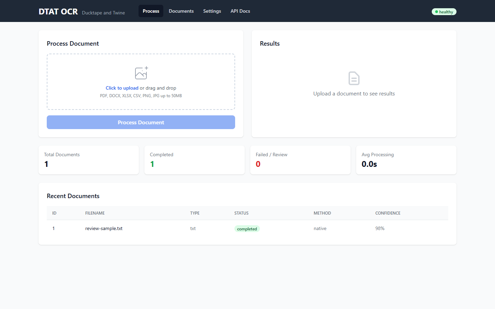
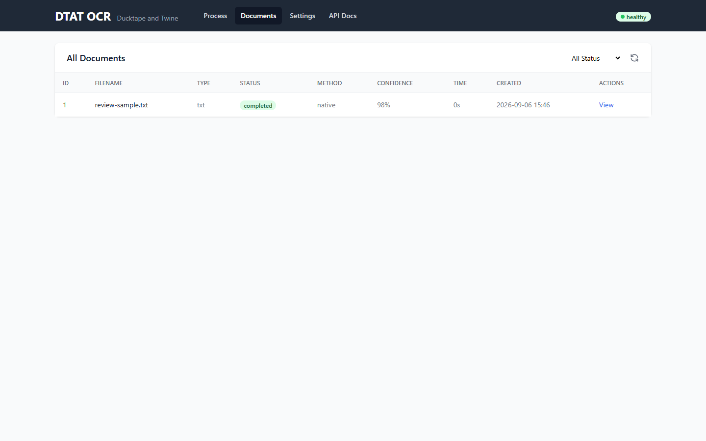
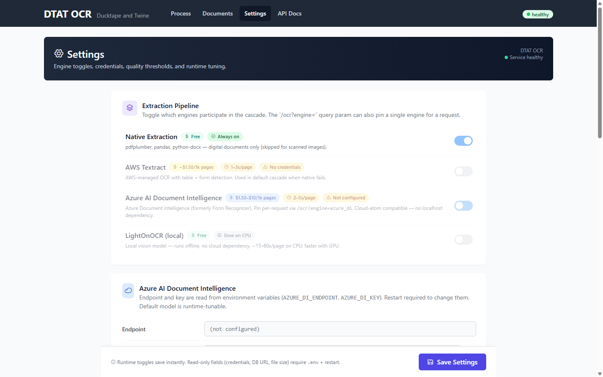
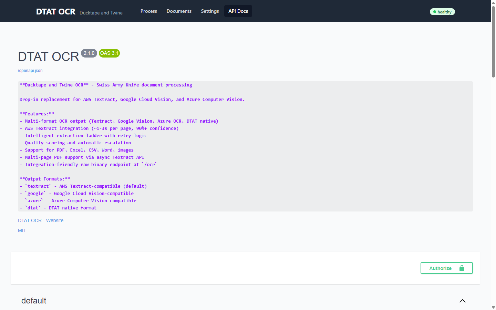
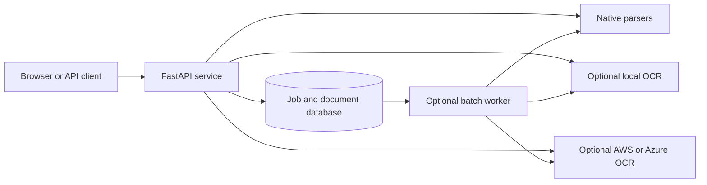

# DTAT OCR

DTAT OCR ("Ducktape and Twine OCR") is a self-hosted document-processing service for PDFs, spreadsheets, Word documents, and images. It combines native text extraction with optional local or cloud OCR, stores processing results, and exposes both a FastAPI service and a browser UI.

## Screenshots

| Process a document | Review processed documents |
| --- | --- |
|  |  |

| Configure extraction engines | Browse the API |
| --- | --- |
|  |  |

## What it does

- Extracts text and tables natively from digital PDF, CSV, Excel, and Word files.
- Can fall back to AWS Textract, Azure AI Document Intelligence, or the local LightOnOCR model.
- Returns native DTAT, AWS Textract-compatible, Google Vision-compatible, or Azure-compatible JSON.
- Supports synchronous requests, queued processing, content-hash deduplication, and reusable extraction profiles.
- Provides an authenticated web dashboard for uploads, document history, runtime settings, and API documentation.

Cloud OCR is disabled by default. A fresh installation does not make paid provider calls until an operator explicitly enables and configures a provider.

## Architecture



The extraction cascade starts with native parsers for digital documents. When configured quality thresholds are not met, it can escalate to enabled OCR engines. Uploaded originals and extracted results are stored in the configured database by default; review the retention guidance in [SECURITY.md](SECURITY.md) before processing sensitive documents.

## Requirements

- Python 3.12
- `uv` or `pip`
- Optional: Docker with Compose
- Optional: AWS credentials, Azure credentials, or a locally cached LightOnOCR model

The browser UI currently loads Tailwind CSS, HTMX, icons, and Swagger UI assets from public CDNs, so those pages need outbound network access.

## Quick start

```bash
git clone https://github.com/NotADevIAmaMeatPopsicle/DTAT-OCR.git
cd DTAT-OCR
python -m venv .venv
```

Activate the environment and install dependencies:

```bash
# Linux/macOS
source .venv/bin/activate
pip install -r requirements.txt

# Windows PowerShell
.venv\Scripts\Activate.ps1
pip install -r requirements.txt
```

Set a non-default password and start the service:

```bash
# Linux/macOS
export DTAT_USERNAME=admin
export DTAT_PASSWORD='replace-with-a-long-random-password'
python -m uvicorn api:app --host 127.0.0.1 --port 8000
```

```powershell
# Windows PowerShell
$env:DTAT_USERNAME = "admin"
$env:DTAT_PASSWORD = "replace-with-a-long-random-password"
python -m uvicorn api:app --host 127.0.0.1 --port 8000
```

Open <http://127.0.0.1:8000>. The health endpoint at `/health` is intentionally public; the UI, API schema, and processing endpoints require HTTP Basic authentication.

## Docker Compose

Copy `.env.example` to `.env`, set `DTAT_PASSWORD` and `POSTGRES_PASSWORD`, then run:

```bash
docker compose up --build
```

Compose starts the API and an internal PostgreSQL service. PostgreSQL is not published to the host. For internet-facing deployments, terminate TLS at a reverse proxy, add rate limiting, and keep the application port on a private network.

## API examples

```bash
# Public liveness/readiness summary
curl http://127.0.0.1:8000/health

# Raw binary OCR
curl -u "$DTAT_USERNAME:$DTAT_PASSWORD" \
  -H "Content-Type: image/png" \
  --data-binary @receipt.png \
  "http://127.0.0.1:8000/ocr?format=text"

# Multipart document processing
curl -u "$DTAT_USERNAME:$DTAT_PASSWORD" \
  -F "file=@invoice.pdf" \
  http://127.0.0.1:8000/process

# Queue a document and inspect the queue
curl -u "$DTAT_USERNAME:$DTAT_PASSWORD" \
  -F "file=@invoice.pdf" \
  http://127.0.0.1:8000/process/async
curl -u "$DTAT_USERNAME:$DTAT_PASSWORD" http://127.0.0.1:8000/queue/status
```

Authenticated interactive documentation is available at `/docs` and `/ui/api-docs`. See [OCR API formats](docs/OCR-API-FORMATS.md) for response schemas and [profile templates](docs/PROFILE-TEMPLATES.md) for structured field extraction.

## Supported inputs

| Format | Native extraction | OCR fallback |
| --- | --- | --- |
| Digital PDF | Text and tables | AWS, Azure, or local OCR when enabled |
| Scanned PDF | No | AWS, Azure, or local OCR when enabled |
| CSV | Rows and columns | Not normally needed |
| Excel (`.xlsx`) | Sheets and cells | Not normally needed |
| Word (`.docx`) | Paragraphs and tables | Not normally needed |
| Text (`.txt`) | UTF-8 text | Not normally needed |
| Images | No | AWS, Azure, or local OCR when enabled |

## Configuration

Environment variables are the deployment source of truth. Runtime engine and quality controls are also available in the settings page.

| Variable | Default | Purpose |
| --- | --- | --- |
| `DTAT_USERNAME` | `admin` | HTTP Basic username |
| `DTAT_PASSWORD` | required | HTTP Basic password; must be at least 12 characters and not a known default |
| `DATABASE_URL` | `sqlite:///documents.db` | SQLAlchemy database URL |
| `MAX_FILE_SIZE_MB` | `50` | Maximum accepted upload size |
| `STORE_ORIGINAL_FILE` | `true` | Store original file bytes in the database |
| `ENABLE_TEXTRACT` | `false` | Enable AWS Textract fallback |
| `ENABLE_LOCAL_OCR` | `false` | Enable the local LightOnOCR fallback |
| `AZURE_DI_ENABLED` | `false` | Enable Azure Document Intelligence |
| `DTAT_AZURE_COMPAT_KEY` | main API password | Key for Azure-compatible endpoints |
| `OCR_OFFLINE_MODE` | `true` | Prevent runtime model downloads |

See [.env.example](.env.example) for the complete starter configuration. Never commit a populated `.env` file.

## Development

```bash
pip install -r requirements-dev.txt
pytest -q
ruff check .
```

The test suite uses a temporary SQLite database and disables paid OCR providers. See [CONTRIBUTING.md](CONTRIBUTING.md) for contribution guidelines.

## Operational limits

- HTTP Basic authentication should only be used over TLS.
- Rate limiting is not built in; add it at the reverse proxy for shared or public deployments.
- Processing untrusted documents invokes complex third-party parsers. Run the service with resource limits and an isolated data volume.
- Original uploads are retained by default. Set and enforce a retention policy appropriate for your data.
- Local OCR is resource intensive; the included CPU image embeds a large model and can take time to build.

Security issues should be reported privately as described in [SECURITY.md](SECURITY.md).

## License

DTAT OCR is licensed under the [MIT License](LICENSE). Third-party packages retain their own licenses; see [THIRD_PARTY_NOTICES.md](THIRD_PARTY_NOTICES.md) before redistributing a bundled image or executable.
